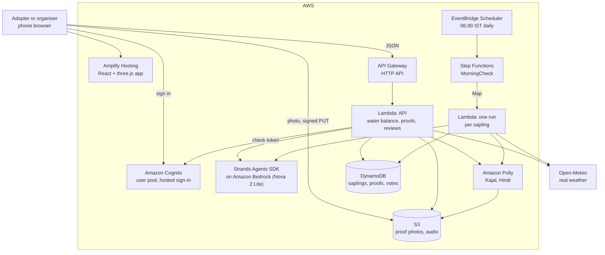

# How Neemu is built on AWS

Region `us-west-2`. Everything below is one SAM stack (`backend/template.yaml`) plus an Amplify Hosting app.



## Where AWS fits

| Service | What it does here | Where |
|---|---|---|
| **AWS Lambda** | The API, and one morning check per sapling | `backend/src/api.py`, `daily.py` |
| **Amazon API Gateway** (HTTP API) | 18 routes, CORS, throttling | `template.yaml` |
| **Amazon DynamoDB** | One table: saplings, adopters, proofs, review votes, cover requests, claimed names | `store.py` |
| **Amazon S3** | Proof and reference photos, uploaded straight from the phone with a signed link; Neemu's spoken lines. Private, 30-day expiry. | `proofs.py`, `speak.py` |
| **Amazon Polly** | Neemu's voice: Kajal, neural, Hindi | `speak.py` |
| **Strands Agents SDK** (AWS open source) on **Amazon Bedrock** | Neemu as an agent with four tools over the water balance | `agent.py` |
| **AWS Step Functions** | The morning check: list the saplings, fan out one check each, summarise. A failing sapling does not stop the rest. | `template.yaml`, `daily.py` |
| **Amazon EventBridge Scheduler** | Starts the morning check at 06:00 IST | `template.yaml` |
| **Amazon Cognito** | Sign-in with a hosted page; an `organisers` group | `auth.py`, `web/src/api/auth.ts` |
| **AWS Amplify Hosting** | Serves the web app over HTTPS, which the camera and location need | `backend/deploy-web.sh` |
| **AWS SAM** (AWS open source) | The whole backend as one template | `template.yaml` |

## What decides what

**Code decides every number and every verdict.** Whether a sapling needs water, how many litres, its health, its status, whether a proof is accepted: all of it is computed in `engine.py` and `proofs.py`.

**The agent only chooses tools and writes sentences.** Its tools return the engine's numbers. Before its reply is used, every number in it is checked against what the tools returned; a reply with a number from nowhere is discarded and a fixed sentence is used instead. The response says which happened (`spokenBy: "agent"` or `"template"`).

**People decide "is this the same tree".** Nothing is attached to a tree. A proof is accepted when the phone was within reach of the sapling and the image has not been sent before, both checked in code. A share of proofs then go to a review queue where the organiser or a neighbouring adopter compares the photo with the reference.

## The water balance

The FAO-56 daily soil water balance (Allen et al., 1998), one soil layer. Depletion is how many millimetres the root zone is short of full.

```
depletion tonight = depletion this morning + Ks x Kc x ET0 - effective rain - watering
```

ET0, rain and maximum temperature are real daily values from Open-Meteo for the sapling's location. Neemu asks when depletion is due to pass 9.8 mm by evening, for `depletion x basin area` litres. The soil and sapling figures are textbook values and are listed in [`backend/README.md`](../backend/README.md).

## Honest limits

- **The agent has not yet spoken in production.** Bedrock model access is not enabled on the team's two-week-old AWS account; quota requests are open. Until it is, every sentence is a fixed template and the app says so. The agent's code, tools and number check are deployed and unit-tested, but untested against a live model.
- **The model is approximate.** One soil type, one root depth and one crop factor for every sapling. It is not calibrated against any real tree.
- **A sapling surviving its first summer cannot be shown in a weekend.** What runs is the daily loop on real weather. The replays (`?date=2026-05-19`, a real 44 °C day) show what the same loop does in the heat.
- **Phone position can be faked**, and GPS cannot tell apart saplings two metres from each other. Position shows the person came; the review queue is what checks the tree.
- **The 40 saplings of the example drive are illustrative.** Their adopters and past care are made up; each has a care pattern that the engine runs against real weather, so their statuses are computed.
- **Reminders do not reach a phone.** The register records that a reminder was sent; no message goes out.
- **Sign-in is optional for now.** Without a token the API believes the name in the request.
